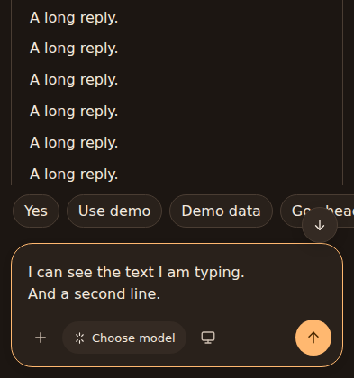

# Issue 19: keep typed text above the keyboard

The native chat WebView now applies IME padding after consuming Scaffold's
existing insets. Opening the keyboard reduces the WebView's usable height,
keeping the composer and suggestions above it without counting the navigation
bar twice. Transcript updates and the scroll-to-bottom button scroll only the
transcript instead of scrolling ancestors of the focused input.

This is a browser preview at 393 × 420, simulating the available height above
the keyboard. It is not an Android device screenshot. The existing composer
design is unchanged.

Run `web/openui/scripts/verify-composer.py` with a Python environment containing
Playwright after rebuilding the embedded frontend. Set
`PLAYWRIGHT_CHROMIUM_EXECUTABLE` if Chromium is installed outside Playwright's
default location. It checks focused multiline typing, snapshots containing a
stale native draft, suggestions and composer visibility at portrait/landscape
keyboard-sized viewports, scrolling limited to the transcript, and sending.

On-device verification: open an existing long conversation with suggestions,
focus the input, type multiple lines, rotate with the keyboard open, then hide
and reopen the keyboard. The draft, composer controls and suggestions should
remain visible above the keyboard. Android IME behavior still needs that device
check; browser resizing alone does not exercise Compose insets.
