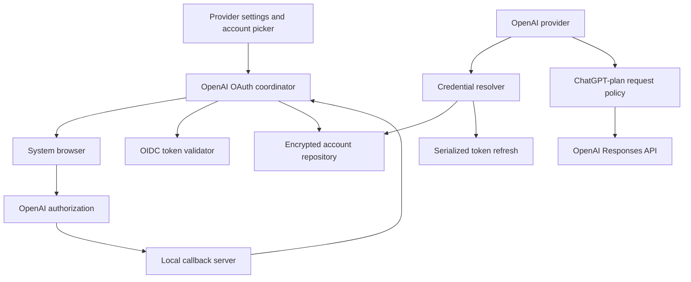

# Draft: OpenAI OAuth in Friendly

Status: implementation in progress on `feat/openai-chatgpt-oauth`. The encrypted account store, browser callback flow, token resolver, account model catalog, Responses API text path, and provider settings controls are implemented and compile. Automated tests and physical-device/live-account validation have not been run yet.

**1. Intended outcome**

A user can open Friendly's provider settings, choose **Continue with ChatGPT**, authorize the app in their browser, select an available model, and chat using their eligible ChatGPT plan. Friendly keeps the connection across restarts, renews access when needed, and provides account selection, sign-out, and a link to manage usage.

The integration will use the open-source Sign in with ChatGPT flow described in the official OpenAI documentation. Its intended audience includes open-source and locally hosted applications. OpenAI directs paid or remotely hosted applications to a separate interest process. Friendly is an Android application that runs locally, but its particular distribution and monetization arrangements should be checked before public rollout. The existing paid-theme work makes this a concrete distribution question. Eligibility should be demonstrated with Friendly, rather than assumed from a successful browser login. [OpenAI integration overview](https://developers.openai.com/siwc/token-sharing-open-source)

Recommended delivery: native Kotlin integration, using Friendly's existing OAuth module and Responses API implementation. The app would contact OpenAI directly under the documented public-client flow. A Friendly backend and client secret are not required by that flow. [Registration and sign-in](https://developers.openai.com/siwc/token-sharing-open-source/sign-in)

Initial scope:

- Browser sign-in, persisted account registrations, account selection, and sign-out.
- Account-specific model discovery and text conversations with local history.
- Collected text results for background tasks such as conversation titles.
- Image inputs and locally executed function/MCP tools after their adapter passes integration checks.
- Clear consent, usage-limit, expired-session, and unsupported-feature states.
- Existing API-key providers remain available as an explicitly selected connection method.

**2. Current code and the gaps to close**

| Existing code | What it already provides | Planned change |
| --- | --- | --- |
| [`ProviderSetting.kt`](../../ai/src/main/java/me/rerere/ai/provider/ProviderSetting.kt) | Serializable OpenAI provider settings, API key, endpoint, Responses API toggle | Add an authentication mode and an opaque account reference |
| [`OpenAIProvider.kt`](../../ai/src/main/java/me/rerere/ai/provider/providers/openai/OpenAIProvider.kt) | Provider operations and API-key model discovery | Resolve OAuth credentials per request; parse the account-specific model catalog |
| [`ResponseAPI.kt`](../../ai/src/main/java/me/rerere/ai/provider/providers/openai/ResponseAPI.kt) | Responses request construction, HTTP generation, and SSE streaming | Add a ChatGPT-plan request policy and a stream-to-result path |
| [`ResponseApiStreamDecoder.kt`](../../ai/src/main/java/me/rerere/ai/provider/providers/openai/ResponseApiStreamDecoder.kt) | Text, reasoning, tool, and terminal-event decoding | Track successful completion separately from incomplete output and transport closure |
| [`OAuthLoopbackCallbackServer.kt`](../../oauth/src/main/java/me/rerere/oauth/OAuthLoopbackCallbackServer.kt) | Loopback listener, state lookup, one-time callback consumption, foreground-service support | Capture the issued client ID; support the required callback path |
| [`OAuthHttpClient.kt`](../../oauth/src/main/java/me/rerere/oauth/OAuthHttpClient.kt) | PKCE, authorization URL construction, code exchange, refresh | Extend token fields and structured errors; add revocation support |
| [`OAuthAuthorizationLauncher.kt`](../../oauth/src/main/java/me/rerere/oauth/OAuthAuthorizationLauncher.kt) | Browser Custom Tabs | Reuse for OpenAI sign-in |
| [`ProviderConfigure.kt`](../../app/src/main/java/app/friendly/assistant/ui/pages/setting/components/ProviderConfigure.kt) | API-key and endpoint editing | Add the ChatGPT account connection controls |
| [`PreferencesStore.kt`](../../app/src/main/java/app/friendly/assistant/data/datastore/PreferencesStore.kt) | Provider persistence and model/provider overrides | Persist references only; keep provider updates separate from credential updates |
| [`BackupManager.kt`](../../app/src/main/java/app/friendly/assistant/data/sync/BackupManager.kt) | Settings, database, local, WebDAV, and S3 archives | Ensure OAuth credentials and installation identity never enter archives |
| [`LogRedactor.kt`](../../app/src/main/java/app/friendly/assistant/data/ai/LogRedactor.kt) | Header, query, JSON, and form redaction | Cover `id_token_hint` and authentication error paths |
| [`DataSourceModule.kt`](../../app/src/main/java/app/friendly/assistant/di/DataSourceModule.kt) | HTTP clients and provider dependency injection | Wire the account repository, coordinator, and credential resolver |

Specific findings:

- The callback DTO currently discards `client_id`, which the initial OpenAI registration needs.
- The token DTO has no `id_token` or `earliest_refresh_at` fields.
- Current OpenAI model discovery reads `data[].id`; the OAuth catalog needs another parser.
- `ResponseAPI.generateText()` sends `stream: false`. Its request builder can emit temperature, output-token limits, ordinary function tools, and arbitrary custom-body overrides.
- The decoder treats `response.incomplete` as terminal and finishes on socket close. OAuth callers need to distinguish termination from successful completion.
- Provider settings are included in backup JSON. Putting OAuth tokens beside `apiKey` would spread those tokens into backups.
- `id_token_hint` is not covered by the current redactor's sensitive-name rules.

**3. Early feasibility milestone**

Before completing the feature, build a small development-only integration on a dedicated feature branch. This is the first implementation milestone, not work performed for this draft.

1. Open the documented sign-in flow on a physical Android phone using the existing browser launcher and foreground callback service.
2. Complete registration, validate identity and granted permission, then retrieve the account's model catalog.
3. Complete one minimal streamed Responses request.
4. Renew access, restart the app, and confirm the saved registration still works.
5. Sign out and verify the local session is unusable and remote revocation is attempted.

Record sanitized outcomes, device/Android version, browser, route, status, and request ID. Keep all credentials out of the evidence. Do not mark the milestone passed merely because authorization returned a code or model discovery succeeded.

Resolve these questions at this milestone:

| Question | Evidence needed | Effect on implementation |
| --- | --- | --- |
| Does the documented flow work for Friendly's Android runtime? | Browser callback, validated tokens, and completed inference on a phone | Establishes that the native design is viable |
| Does the intended account/workspace have permission? | Returned scopes and completed request | Determines actionable eligibility messaging |
| Does Friendly's distribution fit the open-source integration terms? | Review of the documented integration scope; provider clarification if needed | Determines whether the public rollout needs additional approval |
| Does background browser authorization remain reliable? | Browser switching, screen lock, timeout, and notification-permission scenarios | Determines lifecycle fixes |
| Which request features work for this connection? | Minimal text request, then focused image/tool requests | Establishes the capability policy |

If provider access is unavailable, retain the work as a draft and record the specific failure. Do not invent an alternative provider endpoint to make the milestone pass.

**4. Proposed architecture**



Proposed components and responsibilities:

| Component | Location | Responsibility |
| --- | --- | --- |
| `OpenAIAuthMode` and `oauthAccountId` | `ai` provider settings | Describe the selected auth method and reference a local account |
| `OpenAIAccountRepository` | New `app/data/ai/openai` package | Store registrations and credentials; expose sanitized account state |
| `OpenAIOAuthCoordinator` | Same app package | Own sign-in attempts, cancellation, registration, validation, and account activation |
| `OpenAIIdTokenValidator` | Reusable implementation in `oauth` | Validate signed identity using discovery and JWKS |
| `OpenAICredentialResolver` | Interface in `ai`, implementation in `app` | Supply current bearer credentials to provider code |
| `ChatGptPlanRequestPolicy` | `ai` OpenAI provider package | Enforce endpoint, request, and capability rules |
| Account UI state/ViewModel | App settings UI | Present connection state and actions without exposing tokens |

The `ai` module must not depend on `app`. Inject the resolver through `ProviderManager` into the OpenAI provider. Resolve credentials from the explicitly selected account for each request; avoid a global mutable bearer token shared by concurrent provider operations.

Keep OAuth orchestration in application scope so switching to the browser does not cancel it. UI observes sanitized state and can cancel an attempt. Add a narrow, maintained JOSE/OIDC dependency if needed; select it after checking Android compatibility, supported algorithms, and release build behavior. Avoid writing JWT signature verification from scratch.

**5. Data model and storage**

Proposed additive provider fields:

```kotlin
enum class OpenAIAuthMode { API_KEY, CHATGPT_OAUTH }

// Fields added to ProviderSetting.OpenAI:
val authMode: OpenAIAuthMode = OpenAIAuthMode.API_KEY
val oauthAccountId: String? = null
```

These are draft shapes, not final implementation signatures. Existing serialized providers decode to `API_KEY`. Preserve provider/model IDs so assistants and conversation settings keep their references. Selecting OAuth should not automatically replace an existing provider or activate a different payment method.

Use a local account record with three parts:

| Part | Proposed contents |
| --- | --- |
| Registration | Local account ID, issued client ID, verified issuer/subject, display label, email, registration status |
| Credentials | Access token, refresh token, retained ID token, granted scopes, token type, receipt time, expiry, earliest refresh time when supplied |
| Session control | Generation/version, connection state, first-use acknowledgement |

The token reference documents separate token fields and refresh timing information. Parse those values rather than treating every token as an API key or assuming a permanent credential. [Token reference](https://developers.openai.com/siwc/token-sharing-open-source/token-reference)

Proposed Android storage design:

- Encrypt the account repository with AES-GCM using a dedicated Android Keystore key. Use authenticated versioned records and a fresh encryption nonce on each write.
- Place the repository and installation identity under `context.noBackupFilesDir`; use atomic file replacement for each committed credential update.
- Create one installation host identifier and reuse it across account switches and ordinary sign-outs. A fresh installation creates a fresh identifier.
- Keep access tokens out of Compose state, `SavedStateHandle`, provider JSON, clipboard actions, support exports, and generated `toString()` output.
- Expose only account labels, connection status, and permission status to the UI.
- On key invalidation or corrupt storage, require reconnection and preserve conversations/settings. Report the failed vault operation without including its contents.
- Keep ordinary sign-out distinct from removing a saved registration. Account references shared by multiple provider entries should visibly become disconnected together.

Backup/restore policy: provider settings may carry the opaque account reference, but archives contain no account vault, host identity, or OAuth tokens. Restoring onto another installation yields **Sign in again** until a local account is explicitly linked. Audit nested `Model.providerOverwrite` settings as well as top-level providers. Verify local, WebDAV, S3, Android cloud backup, and device transfer paths.

**6. Authorization and Android lifecycle**

Use this compact protocol contract, then implement it behind the coordinator:

| Item | Value/behavior |
| --- | --- |
| Initial registration | `client_id=dynamic_agent_client`; `agent_name_hint=Friendly`; persistent `ext_agent_host_id` |
| Returning registration | Saved issued client ID |
| Authorization | `https://auth.openai.com/api/accounts/authorize` |
| Token exchange | `https://auth.openai.com/api/accounts/oauth/token` |
| Callback | `http://127.0.0.1:<available-port>/auth/callback`; identical URI throughout one attempt |
| Scopes | `openid profile email offline_access resource.invoke chatgpt.tokens.use.direct` |
| Resource | `https://api.openai.com/v1` |
| Attempt protection | Fresh state, nonce, and S256 PKCE |
| First callback | Capture and retain issued client ID before exchange |
| Reauthorization callback | Reject a conflicting client ID |

The callback is an HTTP loopback listener; its path and host must stay consistent across authorizations. OpenAI's registration guide specifies this contract and the code-exchange rules. [Registration and sign-in](https://developers.openai.com/siwc/token-sharing-open-source/sign-in)

Validate the ID token's signature, issuer, audience, expiry, and nonce using the published discovery/JWKS configuration. Match a returning login to its selected registration before replacing credentials. OpenAI's OIDC guidance describes signature validation; implement the native equivalent with the chosen library. [OIDC validation guidance](https://developers.openai.com/siwc/website)

Enable inference only when the token response's granted scopes include `chatgpt.tokens.use.direct`. The requested scopes, callback scopes, and a valid identity token alone are insufficient. [Permission recovery](https://developers.openai.com/siwc/token-sharing-open-source/errors-and-recovery)

Android work:

- Extend `OAuthCallback` with optional `clientId`, and extend the token DTO with optional identity/timing fields. Require the identity fields in the OpenAI sign-in coordinator while keeping MCP call sites compatible.
- Use a separate callback-server instance configured for `/auth/callback`; retain the shared service's session accounting.
- Start the callback listener and foreground service while the activity is visible, then launch the browser.
- Bound each attempt with a timeout; close its listener session and release its service claim on success, cancellation, failure, or timeout.
- Keep PKCE/state/nonce in memory. After process death, expire the attempt and let the user restart safely.
- Fence attempt completion by provider/account and attempt generation. A superseded callback cannot replace a newer account selection.
- Reject malformed or duplicate security parameters. Test callback replay and unexpected local requests.
- Make callback-page wording describe that Friendly received authorization; final app connection status appears only after token validation succeeds.
- Handle browser-launch and foreground-service failures as recoverable UI errors.

Persist a newly issued registration separately from an active, validated session. If exchange fails, retain enough registration state to retry sign-in without presenting an unvalidated identity as connected.

**7. Refresh, sign-out, and concurrent requests**

Refresh uses the saved client ID and refresh token with the same resource. Save rotated credentials together, serialize refresh operations per session, and discover the revocation endpoint for sign-out. Retain the account/client mapping for a later login. OpenAI describes both the renewal and revocation operations. [Accounts and sessions](https://developers.openai.com/siwc/token-sharing-open-source/profiles-and-sessions)

Proposed coordination rules:

1. At request start, capture the selected account reference and session generation.
2. If renewal is due, use one shared refresh operation for that account. Concurrent requests await its result.
3. Commit replacement credentials atomically before making them available to new requests.
4. Check the session generation again before committing a refresh or accepting a login result.
5. On sign-out, stop new requests, invalidate pending activation, cancel that account's active calls, and coordinate revocation with any refresh already underway.
6. Clear local credentials even when remote sign-out cannot be confirmed; show the documented recovery path in that case.

Honor supplied refresh timing, use a small configurable expiry margin, and tolerate modest clock skew. Refresh on demand; periodic background jobs are unnecessary for the first version.

Do not automatically repeat a partially streamed request or a tool execution. A narrowly bounded retry may be considered before any stream output, after a confirmed credential refresh. A temporary network failure must not erase a usable session. If rotated-token persistence fails, mark the connection as needing attention and avoid repeatedly submitting the old refresh token.

**8. Provider transport, models, and capabilities**

Use `GET https://api.openai.com/v1/models` with the selected account's credential. The OAuth catalog is `models[]`, with `slug`, `display_name`, and `visibility`; preserve display ordering and refresh on account changes. Inference uses `POST https://api.openai.com/v1/responses`. Treat success as receiving `response.completed`; an incomplete or interrupted stream is a separate outcome. [Models and inference](https://developers.openai.com/siwc/token-sharing-open-source/models-and-inference)

Implementation changes:

- Keep OAuth model catalog parsing separate from the existing API-key parser. Cache results per registration, not globally.
- Preserve local model UUIDs when refreshing a catalog, matching server model slugs within the same provider/account. Mark unavailable saved selections so the user can choose another model.
- Force the documented official endpoints for OAuth. Check the final URL after model/provider overrides, and prevent redirects from carrying credentials to another destination.
- Set one Authorization header after validating custom headers; reject an override or duplicate bearer header.
- Keep API-key rotation confined to API-key connections.
- Add an explicit request policy selected by auth mode. Validate after custom-body merging so a saved override cannot re-enable an incompatible option.
- Implement `generateText()` for OAuth by consuming and collecting the streaming response into the existing result type. Background tasks and the connection tester must follow this path too.
- Extend terminal state in the decoder or its OAuth wrapper so partial output is preserved for display without being accepted as a completed background result.
- Keep typed status, error code/parameter, and request ID available to app-level recovery without logging credentials.

Current documented request restrictions include `stream: true`, `store: false`, an input array containing required history, and instructions/developer messages. Unsupported fields include sampling parameters, output-token limits, persistent conversation IDs, background mode, and several metadata/advanced options. Supported tool representations have constraints; hosted image generation, file search, Code Interpreter, hosted MCP, and tool search are unavailable. Audio/video input and Files/transcription API calls are outside this flow. [Preview limitations](https://developers.openai.com/siwc/token-sharing-open-source/preview-limitations)

Proposed capability policy:

| Feature | First-version behavior |
| --- | --- |
| Text conversation and reasoning | Enable with verified model capabilities |
| Temperature/output-token controls | Disable for this connection and explain the reason |
| Image input | Enable after validating existing attachment serialization |
| File input | Allow only a verified supported representation; prevent upload-API credential use |
| Local function/MCP tools | Adapt to supported namespaced/custom tool representation; validate tool-call/result round trips |
| Server web search | Expose only when verified for the selected model/account |
| Embeddings, image generation/editing, audio/video services | Reject for this connection before sending a network request |
| Custom endpoints and Authorization headers | Require an API-key connection |
| Arbitrary custom request fields | Validate against the supported policy and report conflicts |
| Balance display | Link to usage management rather than calling API-key balance endpoints |

Local MCP tools continue to execute through Friendly's tool system. Their individual server authorization stays with the MCP integration; the OpenAI request carries only the supported tool declarations and resulting data.

**9. Proposed user experience and review mockups**

Use **Continue with ChatGPT** for browser authorization. OpenAI's guidance calls for a first-use confirmation, a visible indication when requests use the ChatGPT plan, and a nearby usage-management link. Usage-limit messaging should lead to usage settings. [UI/UX guidelines](https://developers.openai.com/siwc/ui-ux-guidelines)

Draft wireframes for review:

```text
Settings > Providers > OpenAI

Connection method
[ API key ]  [ ChatGPT account ]

Use your ChatGPT plan
Connect your account for eligible AI requests.

[ Continue with ChatGPT ]
```

```text
Settings > Providers > OpenAI

Connection method
[ API key ]  [ ChatGPT account ]

Connected account
user@example.com · Personal connection
ChatGPT plan usage enabled

[ Choose account ]   [ Manage usage ]
[ Sign out ]

Models
[ Refresh models ]
```

```text
Chat composer / model selector

Selected model
Using ChatGPT plan · Manage usage

[ Message input...                       ]
```

Account states: disconnected; awaiting browser; validating; connected; plan permission disabled; refreshing; sign-in required; temporary service failure. Successful identity login with no inference permission should offer **Enable ChatGPT plan usage**. Account labels must distinguish separate registrations that happen to share an email.

Use a one-time confirmation for the first enabled connection. Show accessible progress/cancel controls during login. Preserve the draft message and partial response on errors. Hide or explain unavailable controls in the context where the user would use them. Never silently change to an API-key billing path after a plan limit or auth failure.

Both `SettingProviderPage` and `SettingProviderDetailPage` have provider-editing flows; audit and connect both to the same account state. Audit model-level provider overrides and the connection tester so they cannot bypass the selected method.

During implementation, turn these wireframes into reviewable light/dark mobile mockups. The repository's `AGENTS.md` requires mockups and Greg's approval before UI changes reach `friendly-2.0`. That is a merge/release gate; it does not prevent developing the feature on its own branch.

**10. Error and recovery behavior**

OpenAI documents declined permissions, terminal refresh failures, eligibility and usage errors, and failures after streaming starts. Its recovery guidance also distinguishes temporary admission failures from invalid credentials. [Errors and recovery](https://developers.openai.com/siwc/token-sharing-open-source/errors-and-recovery)

| Condition | Planned Friendly response |
| --- | --- |
| Browser cancellation, callback expiry, or failed token validation | End the attempt; keep the previously active account |
| Identity connected without plan permission | Retain the registration; offer an explicit permission action |
| Terminal refresh-token error | Clear unusable tokens; offer sign-in for the saved registration |
| Eligibility/policy rejection | Explain the restriction; stop automatic OAuth/request loops |
| Usage limit | Preserve the conversation; show Manage usage as the primary action |
| Temporary network/service failure | Preserve credentials; offer bounded retry |
| Unsupported request capability | Identify the conflicting setting and correct it before retry |
| Remote disconnection detected | Mark the session disconnected and request sign-in |
| Failed/incomplete stream | Show partial output with an unfinished state; require explicit retry |
| Remote revocation unconfirmed | Complete local sign-out and explain how to disconnect in ChatGPT settings |

Preserve sanitized diagnostic context. Token endpoint exceptions currently include response-body text; audit those paths before reusing them for OpenAI. Authentication traffic should use a dedicated client with safe diagnostics and no prompt-log capture. Add `id_token_hint` redaction and verify form-body/error redaction as well as headers.

**11. Implementation sequence and acceptance gates**

| Milestone | Deliverable | Acceptance gate |
| --- | --- | --- |
| 1. Feasibility | Development-only Android OAuth-to-inference path and sanitized findings | Real phone completes authorized inference; distribution questions documented |
| 2. Accounts and lifecycle | Encrypted vault, OIDC validation, registration, refresh, sign-out, and races handled | Security/lifecycle tests pass; restart and revocation work |
| 3. Provider integration | Additive auth fields, credential resolver, catalog parser, request policy, stream collection | Text chat and background generation complete through public endpoints |
| 4. Tools and attachments | Verified capability gates and supported tool/image adaptation | Tool round trip and supported attachments work; incompatible operations fail locally |
| 5. UI | Connection controls, account picker, confirmation, usage links, recovery states | Reviewable mockups approved; both settings flows work |
| 6. Regression and delivery | Focused tests, backup checks, signed build, review notes | Required checks pass; Greg approves UI before merge to the shipping branch |

Develop on a dedicated branch based on the intended current integration branch. Keep changes as reviewable commits: shared OAuth extensions; account/session infrastructure; provider policy; UI/recovery; verification. Confirm branch ancestry before implementation so this feature does not accidentally include unrelated issue work.

Publish to the nightly release only after merge/release authorization and the applicable UI approval. Greg installs from that release, so final device acceptance should use the signed nightly APK. The existing build pipeline supplies the delivery mechanism.

**12. Planned verification**

These checks are for the implementation phase. No tests or live API calls were run to prepare this draft.

| Area | Meaningful cases |
| --- | --- |
| Callback security | Issued/missing/conflicting client IDs; wrong state; duplicate parameters; callback replay; cancellation and timeout |
| OIDC validation | Wrong signature/issuer/audience/nonce; expired token; JWKS key rotation; returning identity mismatch |
| Refresh/session races | Parallel requests cause one refresh; refresh cannot commit after sign-out; account switching keeps credentials isolated; rotation persistence failure |
| Storage and backups | No plaintext token in files/settings/archives; vault excluded from backup/transfer; corrupt/invalidated key recovery; restore requires reconnection |
| Provider boundaries | Custom endpoint/redirect/header injection rejected; provider overrides cannot leak tokens; API-key mode still works |
| Request format | Required flags enforced after custom merges; forbidden fields rejected; account-specific catalog parsing and stable local model IDs |
| Streaming | Completed, failed, incomplete, socket close, and user cancellation; usage error after text begins; collected background result matches streamed output |
| Tools/attachments | Supported function declaration, call, result, and continuation; MCP round trip; unsupported upload or media path rejected before credential use |
| Diagnostics | Access/refresh/ID tokens, OAuth codes, PKCE verifier, and `id_token_hint` absent from logs and errors |
| Android behavior | Browser return, activity recreation, app backgrounding, screen lock, process death, denied notification permission, and simultaneous MCP authorization |

Use local HTTP fixtures and signed synthetic JWTs for deterministic automated tests. Use fake credentials in test data. Limit live account testing to the feasibility and final device checks.

During implementation, run the affected `oauth` and `ai` unit tests, targeted app tests, and the repository's required app suite (`./gradlew :app:testNightlyDebugUnitTest`). Compile the nightly debug variant and produce a signed nightly build for final device acceptance. Confirm exact module test task names from Gradle before running them.

**13. Definition of done**

- A fresh installation connects a ChatGPT account and completes an eligible chat request.
- App restart, access renewal, account selection, and sign-out behave consistently.
- No OAuth credential appears in exported provider settings, archives, logs, or UI state.
- All OAuth requests stay within the approved provider routes and enforce capability restrictions.
- Stream errors cannot be reported as successful generation or trigger automatic duplicate tool execution.
- Existing provider/assistant IDs survive migration and API-key use passes regression checks.
- Users can see when their ChatGPT plan is being used and where to manage its usage.
- Android/browser feasibility, integration eligibility, automated checks, UI approval, and signed-nightly acceptance are recorded before public rollout.

The largest unresolved item is end-to-end availability for Friendly's specific Android/distribution setup. The feasibility milestone is designed to resolve it before the rest of the implementation depends on it.
